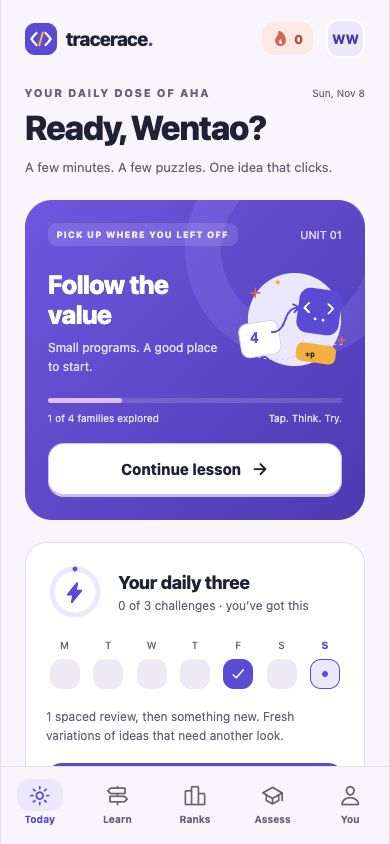
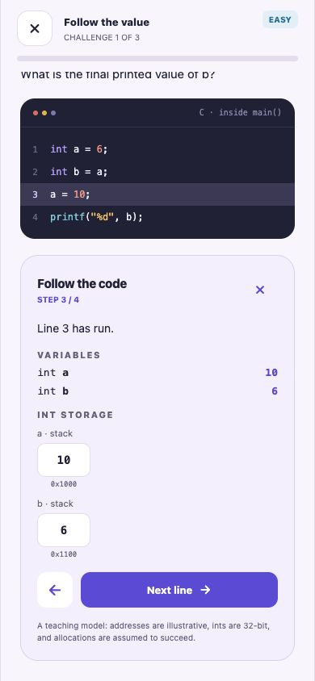
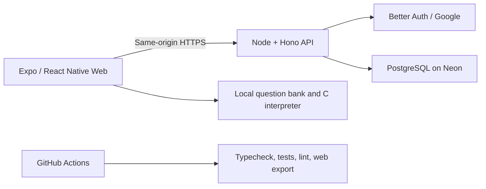

# TraceRace

Short computer science practice for a phone-sized screen. Predict what a small program does, step through its memory, and come back to the ideas that need another look.

Built by [Wentao Wu](https://github.com/d-wt-wu), a Computer Science Co-op student at the University of Toronto Scarborough.

**[Open the public web beta →](https://tracerace.onrender.com/)** · [Engineering case study](docs/CASE_STUDY.md) · [Verification evidence](docs/evidence/web-beta.json)

Guest practice works without an account or download. Google sign-in adds cloud saves. Free hosting can take about a minute to wake after inactivity.

## Try it in two minutes

1. Open the app and select **Learn → Follow the value**.
2. Predict the answer, then use **Trace the code → Next line** to watch variables change.
3. Explore **Assess** for an 18-question skill check, or **Ranks** for the optional weekly league.

On iPhone, open the app in Safari and use **Share → Add to Home Screen**. Android Chrome offers **Install app** or **Add to Home screen** when available. A network connection is needed to load the web app and sync. [Help and privacy](https://tracerace.onrender.com/support).

<p>
  
  
</p>

Actual web beta screenshots, captured November 8, 2026 in a resized desktop browser.

## What it does

- **36 question families across nine units**, with Easy/Medium/Hard labels, seeded input variants, hints, and explanations. Topics cover C memory, algorithms, data structures, complexity, SQL, and systems reasoning.
- **Visual C execution:** a tokenizer, Pratt parser, and bounded interpreter produce statement-by-statement variable and memory snapshots. Teaching faults explain unsafe accesses without executing unsafe native code.
- **Personalized daily three:** overdue reviews come first, followed by a new concept. Independent early practice preserves the review interval; help brings the concept back sooner.
- **Separate skill and activity rankings:** an 18-question, six-topic weighted assessment and a weekly XP board. Nicknames and ranking visibility are optional; profiles start private.
- **Account-aware progress:** Google sign-in, guest-progress import, cloud save conflicts, session restoration, sign-out, and account deletion with cascading removal of synced records.

## Engineering choices

| Problem                                   | Implementation                                                                                                                                                                          |
| ----------------------------------------- | --------------------------------------------------------------------------------------------------------------------------------------------------------------------------------------- |
| Explain code without a remote code runner | A deterministic C teaching model runs in the client. The same snapshots drive the answer explanation and visualizer. It does not use `eval`.                                            |
| Keep browser accounts on one origin       | A Node server serves the Expo web export and Hono/Better Auth API together; browser sessions use HttpOnly cookies.                                                                      |
| Avoid trusting a submitted XP number      | Expiring HMAC question tickets bind the player, family, seed, and bank version. The server grades answers; row locks and uniqueness constraints make concurrent submissions idempotent. |
| Avoid silently losing a cloud save        | Revision checks reject stale writes and ask the user which copy to keep. Device-only assessment drafts and haptics stay local.                                                          |
| Recover persistent app data               | Transactionally consistent AES-256-GCM backups restore only into an empty, isolated restore-check target with matching migration hashes. Sessions are excluded.                         |

**Stack:** TypeScript · React Native · Expo SDK 57 · Expo Router · Hono · Better Auth · Drizzle ORM · PostgreSQL on Neon · Render · GitHub Actions.



## Verification

The [deployed code's GitHub checks](https://github.com/d-wt-wu/tracerace/actions/runs/42530175907) passed on November 8, 2026:

- **111 unit, content, and regression tests**, plus **22 real PostgreSQL API integration tests**.
- **36 sampled defined-behavior C variants** compiled with clang C17 and compared against the teaching model. Undefined-behavior lessons are never executed as native C.
- TypeScript, lint, production web export, generated SQL checks against PostgreSQL, and native JavaScript exports.
- Public-origin Google sign-in, sign-out, returning sign-in, session reload, cloud-save conflict rejection, and disposable-account deletion checks.
- An encrypted backup/restore round trip across eight persistent tables, with wrong-target and nonempty-target rejection.

These are implementation checks, not user counts or measured learning outcomes. See the [release evidence](docs/evidence/web-beta.json) for scope and remaining gaps.

## Run locally

Use Node.js 22 or newer and a separate development PostgreSQL database. Copy the example environment and fill in your own server settings; never commit the completed file. [Account and database setup](docs/AUTH_SETUP.md).

```sh
npm ci
cp -n .env.example .env.local
npm run db:migrate
npm run api
```

In a second terminal:

```sh
npm run web -- --localhost --port 8081
```

Open http://localhost:8081/. The local API uses http://localhost:8787; keep both on localhost for browser cookies. Google login needs your own OAuth client and registered callback. Guest practice does not need a Google account.

```sh
npm run check
npm run test:api
```

`check` covers formatting, TypeScript, unit/content/regression tests, safe C reference comparisons, lint, and a web export. API tests need a migrated test database, refuse the `main` branch, and remove only their own test records. CI provisions its own PostgreSQL service.

## Scope and limits

- This is a **public web beta**. The React Native source is included, but no signed iOS/Android release or App Store/TestFlight distribution has been made. Actual phone testing and external tester feedback remain outstanding.
- The web beta uses Free hosting and can sleep while idle. Home-screen metadata is included; there is no service worker caching private responses and no offline-installation promise.
- The interpreter supports a curated C subset, uses illustrative addresses and 32-bit integers, and assumes allocation succeeds. It is not a conforming C compiler. [Engine limits](docs/ENGINE.md).
- Difficulty is curated, not calibrated. Playful assessment titles are not percentiles or professional qualifications. Repeated content does not create unlimited XP. [Ranking rules](docs/RANKINGS.md).
- Password registration stays disabled in the public beta until verification/recovery delivery is configured. Google and guest practice are available.
- There are no fabricated competitors, download counts, retention figures, or measured learning gains. Product analytics are not enabled.

All lesson content and the teaching interpreter are original. Authentication and other dependencies are third-party software. `vendor/decode-uri-component` retains its upstream MIT license, with its ESM default export converted to CommonJS for the SDK 57 Router.

[Web deployment and recovery](docs/WEB_RELEASE.md) · [Release plan](docs/RELEASE_PLAN.md) · [Report a bug](https://github.com/d-wt-wu/tracerace/issues/new)
